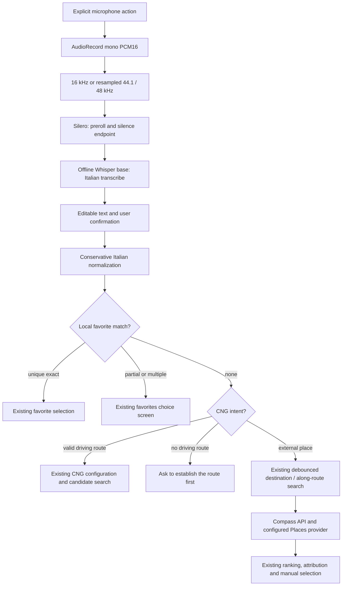

# ADR 0023: Offline Italian voice input for existing destination search

## Status

Implemented for Android 0.28.55. Physical-device recognition, audio routing and performance
acceptance remain pending; compilation and fixture tests do not establish those results.
The operator reported poor recognition on FP4 on 6 November 2026: the quality gate has failed.
See [0.28.56 investigation and general favorite matching](../phases/android-0.28.56-voice-quality.md).

## Existing architecture inspected before implementation

- `RoutePlannerScreen.DestinationSearchContent` owns the destination/origin/ordinary-stop text
  field and its IME state. `RoutePlannerViewModel.openPlaceSearch`, `updatePlaceSearchQuery`,
  `scheduleDestinationSuggestions` and `selectDestinationSuggestion` already manage session IDs,
  query revisions, the 800 ms debounce, geographic context, results and explicit selection.
- `RoutingRepository` is the existing API boundary. The backend's
  `search/destination_service.py`, `search/google_places.py` and `search/along_route_search.py`
  own Google Places New calls, provider fields, attribution, route context and ranking.
  Voice input must not create another Google client or bypass the selection boundary in
  ADRs 0021/0022. Confirmed external voice queries enter the same debounced search path as typing.
- `FavoritePlaceRepository`, `openFavoritePlaces` and `selectFavoritePlace` already hold private
  coordinates/names, including the saved parking location. Exact named favorites can be resolved
  locally. `openAddStop` already opens the CNG workflow for an existing valid driving route;
  there is no independent nearby-CNG voice search to duplicate.
- `AppContainer` provides shared components. The search screen is foreground-only; existing
  navigation TTS, location services and MapLibre rendering do not need a new microphone service.

## Decision

Use the official Kotlin API in sherpa-onnx **2.0.1**, the CPU AAR with statically linked ONNX
Runtime. Gradle downloads that release into the ignored build directory and verifies its fixed
SHA-256 before using it. The universal APK retains all four supplied ABIs; compressed native
libraries keep it below the repository's 100 MiB file boundary and are extracted at installation.
No Maven substitute, extra Android inference framework or cloud speech recognizer is added.

Use multilingual Whisper **base**, int8 encoder/decoder, forced `language=it`, `task=transcribe`,
two CPU threads; Silero VAD uses one. `VoiceModelCatalog` pins model filenames, sizes, SHA-256 and
the Whisper repository revision. Models are separate from the APK and downloaded only after
explicit consent, into `noBackupFilesDir/voice-models/<version>`. Downloads use a dedicated
unauthenticated HTTP client, bounded streaming, `.part` files and atomic verified-file replacement.
Retries retain only already verified complete files; interrupted files are restarted, not resumed
with HTTP Range. Hashes are rechecked before native loading. Users can delete models in the dialog.
`WhisperModelSpec` provides a versioned replacement point for small; no small model is downloaded
or presented as validated in this release.

`VoiceSearchController` serializes downloads, verification, native loading, audio capture and
inference on one dedicated worker. UI state alone is published on Main. The microphone closes
and exclusive transient audio focus is released **before** decoding. Native objects are released
on their owning worker after use, also on errors. Closing/leaving/backgrounding the screen cancels
capture/download and prevents delivery of a late transcript. The synchronous native decode cannot
be interrupted safely: cancellation discards its result and releases resources when it returns;
another native session cannot overlap it.

`VoiceTiming` is the typed configuration point: initial silence 8 s, minimum speech 224 ms,
preroll 500 ms, trailing silence 1.2 s, maximum utterance 20 s. Captured samples drive the timers.
The maximum produces an error rather than silently decoding a cut-off sentence. `Fine` explicitly
ends recording. The low-pass streaming resampler preserves phase across AudioRecord reads.
Audio is bounded in RAM, never saved by the production path or sent to the backend.

The microphone permission is requested only for an explicit recording. Audio focus denial,
calls/VOIP, route changes, Android capture silencing, stopped data delivery and recorder errors
fail visibly. The handset microphone is preferred even when Bluetooth is connected; if unavailable,
the user receives an error. This release does not switch to an unverified Bluetooth SCO input or
request Bluetooth permissions. Actual OEM/audio-route behavior requires device acceptance.

## Query and privacy boundary

Italian normalization removes navigation commands and their leading preposition, normalizes
whitespace/street markers, and converts explicit `numero`/`civico` numbers up to 9999. It preserves
proper names and street dates such as Via Quattro Novembre. Case/accent-insensitive **exact**
favorites take precedence over external search: `Portami al lavoro` selects the saved Lavoro
through the existing method, without starting navigation. Whole-word partial matches and name
collisions require a choice. Parking also resolves by `parcheggio`. No fuzzy automatic selection
or additional LLM is used. A metano/CNG intent opens existing CNG planning, preserving its
reachability/detour rules; absent a driving route it explains that prerequisite.

In 0.28.56, `FavoriteVoiceResolver` expands this catalog lookup to contextual articles/possessives,
spoken numbers and joined/split names. Bounded spelling-distance suggestions require explicit
selection. Unknown explicit favorite requests stay in the local saved-places screen. This is
post-recognition resolution; favorite names are not injected as acoustic decoder prompts.

The user can inspect/edit the raw transcript before `Usa testo`. Only after confirmation does
the normalized external query enter the existing network search. Offline transcription and
favorite lookup do not turn external POI search or routing into offline services. No audio or
transcript is written to application diagnostic logs. Logs contain numeric timing/PSS metrics
and fixed error codes only. Debug logging in the native models is disabled.

## Verification and sources

JVM tests exercise normalization, favorite precedence/ambiguity, CNG dispatch, existing search
debounce/geographic bias, endpoint timing, resampling continuity/anti-aliasing, SHA validation,
corruption, verified-file reuse and download cancellation. An opt-in device instrumentation
benchmark supplies a private WAV to the real native decoder; it does not contact providers.
See [acceptance and benchmark instructions](../phases/android-0.28.55-offline-voice.md).

Official references: [sherpa 2.0.1 release](https://github.com/k2-fsa/sherpa-onnx/releases/tag/v2.0.1),
[Android AAR](https://github.com/k2-fsa/sherpa-onnx/blob/v2.0.1/android/SherpaOnnxAar/README.md),
[Kotlin recognizer](https://github.com/k2-fsa/sherpa-onnx/blob/v2.0.1/sherpa-onnx/kotlin-api/OfflineRecognizer.kt),
[Kotlin VAD](https://github.com/k2-fsa/sherpa-onnx/blob/v2.0.1/sherpa-onnx/kotlin-api/Vad.kt),
[Whisper export/model documentation](https://k2-fsa.github.io/sherpa/onnx/pretrained_models/whisper/tiny.en.html),
[pinned multilingual base files](https://huggingface.co/csukuangfj/sherpa-onnx-whisper-base/tree/bb53ee204431c90d314c1cc08d28d23e5b7927cc).
