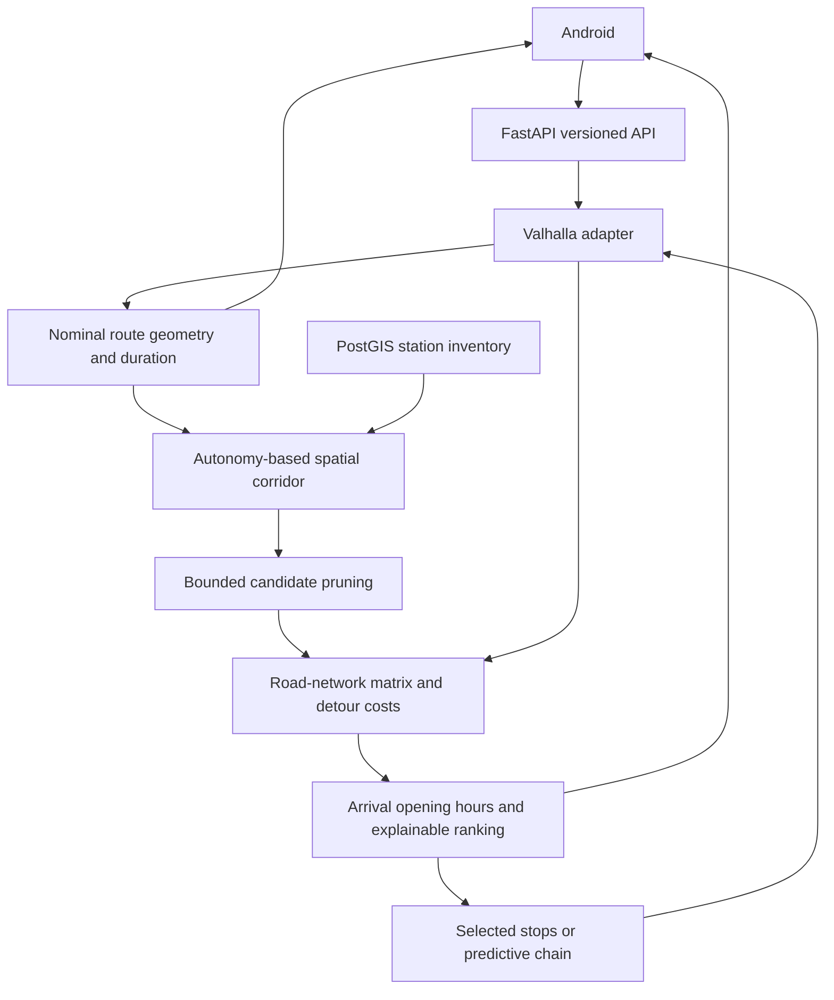

# Architecture

## Responsibilities

| Component | Owns |
| --- | --- |
| Source adapters and ETL | MIMIT/OSM acquisition, immutable payloads, parsing, timestamps and restartable imports |
| PostgreSQL/PostGIS | Station geography, spatial indexes, price observations, reconciliation and provenance |
| Routing adapter | Valhalla HTTP requests, costing options, units, geometry validation and error translation |
| CNG domain services | Corridor pruning, road-network detours, reserve reachability, opening status and explainable ranking |
| FastAPI | Strict versioned request/response contracts, authentication and dependency health |
| Android | Interaction, saved profiles/routes, GPS guidance, presentation and update consent |

The backend returns domain data rather than widget placement or colors. Provider-specific
responses do not cross the mobile API boundary. See [API](api.md), [ADRs](adr/) and
[data-source rules](data-sources.md) for contracts and rationale.

## Data ingestion

MIMIT supplies authoritative station identity and official price observations. OSM
supplies complementary metadata such as opening hours and contact information. Imports
preserve original payloads and separate source timestamps from ingestion time.
Normalization uses deterministic, versioned reconciliation and explicit matched,
ambiguous and unmatched outcomes. Manual overrides are auditable; OSM enrichment does
not silently overwrite MIMIT source fields. Missing geography remains explicit.

Price observations are deduplicated independently of current-price pointers. Repeated
inputs reuse ingestion/reconciliation results where the policy and inputs are unchanged.
Source acquisition failures must not erase previously valid data from another source.

## Route and CNG pipeline

The corridor defaults to 20% of effective CNG range, with configurable caps. Straight-line
metrics only prune candidates. Eligibility and displayed station distance use road costs;
detour is candidate travel time minus base travel time. Predictive planning additionally
validates remaining fuel/reserve and the complete refuelling chain. A full-refill
assumption and any gasoline fallback remain explicit domain policy.

Valhalla supplies nominal automotive durations using constrained/freeflow graph speeds;
pedestrian and bicycle requests use dedicated costing. Highway exclusions are enforced
by the routing adapter/runtime configuration. Departure timestamps anchor arrival and
opening-hours calculations. Planned dwell is separate from driving duration and advances
subsequent arrivals. Unknown opening hours are never treated as known open.

## Navigation and recovery

Android converts the server route into guidance state, filters GPS fixes, matches progress
to the route and updates remaining duration locally. Ordinary and fuel stops retain
explicit lifecycle state. Manual recalculation, deviations and connectivity recovery may
request a new route while preserving relevant remaining stops and destination.

The foreground session supports voice and Picture in Picture. Cached route geometry and
maneuvers can support an existing journey during an outage; new routing requires the
backend. MapLibre ambient caching only covers previously visited resources. Saved-route
format validation is independent of optional retired metadata.

Destination search is server-side and provider-configured. Search credentials never
belong in the mobile app. Provider attribution and storage constraints remain distinct
from routing geometry. Android's updater uses a separate download client without API
authentication; see [client updates](client-updates.md).

Optional Android voice input runs AudioRecord, Silero VAD and Italian Whisper base on a dedicated
CPU worker. After editable confirmation, exact local favorites are selected through the existing
favorite repository; external queries enter the existing destination/along-route search; CNG
requests enter existing route-based planning. Models are private, downloadable and SHA-256 pinned.
No audio reaches the backend and no speech server is introduced. Offline transcription does not
provide offline geocoding/routing. See [ADR 0023](adr/0023-offline-voice-destination-search.md).

## Runtime and verification

Compose separates the API, PostgreSQL/PostGIS, Valhalla and one-shot migration/import/
graph-building jobs. Graph and database storage persist across service recreation.
The API is the public boundary; the operator owns HTTPS ingress and secrets. Liveness,
readiness and source freshness serve different purposes.

Fixture/unit tests validate local contracts. Database integration, external-provider
behavior and physical navigation require their own environments and evidence. Current
operational instructions are in [deployment](deployment.md) and [Android](android.md);
[history](history.md) summarizes older milestones without treating them as current proof.

## Enforcement data and client maps

The [source-preserving PostGIS catalog](phases/enforcement-inventory.md) imports OSM camera
nodes and enforcement relations, preserving unknown fields and quarantining unresolved records.
[Versioned associations](phases/enforcement-association.md) match explicit single-way from/to
relations to directed Valhalla edges and invalidate evidence on source/graph changes.

[Bounded road context](phases/enforcement-road-context.md) provides a backend GPS-trace match;
a plausible match alone is not evidence of unique vehicle carriageway or warning eligibility.
[Control snapshots](phases/enforcement-packages.md) expose bounded spatial inventories with
current association evidence, source/graph identities, attribution and explicit truncation.

Android consumes these snapshots for [map display and a bounded last-area cache](phases/android-0.28.53-enforcement-map.md)
in both navigation and free follow, reusing existing GPS fixes and HTTP/authentication settings.
Directional evidence stays separate from physical-device deduplication for map icons.

[Approach checks](phases/android-0.28.54-enforcement-approach.md) combine a bounded GPS trace,
Valhalla directed matching and competing-road checks with current control associations. Android
consumes the resulting short corridor for local visual/voice warnings in guidance and free follow,
with speed-based thresholds and passage deduplication. Inventory points alone do not authorize alerts.
Offline continuation is limited to a recently verified in-memory corridor, not fresh road matching.
Full offline road-network packages, multi-way associations, Tutor average-speed tracking, MIT
ingestion and scheduled enforcement jobs remain outside the implemented subset.
